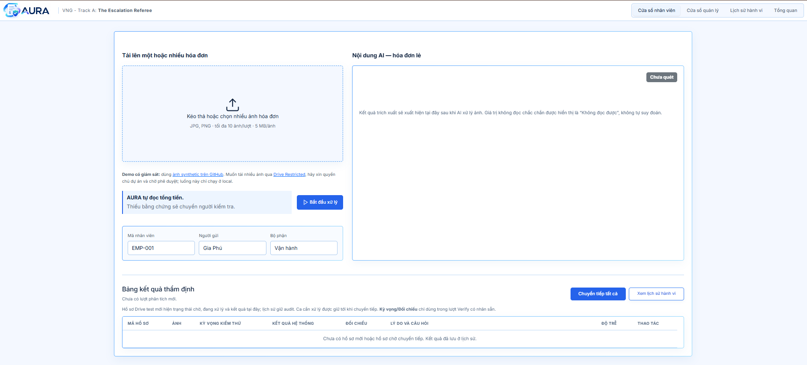

# AURA — Supervised AI for reimbursement receipts

AURA reviews expense receipts, extracts verifiable facts, applies deterministic reimbursement rules, and sends uncertain cases to a person. It was built for **VNG Track A**, **The Escalation Referee**. This repository is a supervised MVP: **the AI suggests facts; C# policy and a reviewer make the decisions**.



## How it works

`Web JPG/PNG or local synthetic Drive → private receipt storage → SQL queue → image privacy gate → vision model → schema and Semantic checks → C# policy → automatic result or human review → audit and reports`

The queue survives restarts and currently permits one AI request at a time. A reviewer can accept, reject, or undo a decision. See the [business rules](AURA/BUSINESS_RULES.md) and [current project status](AURA/docs/CURRENT_PROJECT_STATUS.md) for exact behavior and evidence.

**Live synthetic demo:** [Open AURA](https://bondphupham-001-site1.ltempurl.com/) on SmartASP through **20 November 2026**. Only approved synthetic images can reach the AI model; Restricted Drive intake runs locally. See the [live validation](AURA/docs/SMARTASP_LIVE_VALIDATION_2026-10-28.md). After the trial, use the local setup below and request a trial API key from the author privately.

## Explore the app

| Area | What it shows | Suggested screenshot |
| --- | --- | --- |
| **Cửa sổ nhân viên** | Upload up to 10 JPG/PNG receipts per submission; follow processing and inspect extracted facts. | Upload box beside AI facts and result table. |
| **Cửa sổ quản lý** | Human review, decision, and Undo. | One escalated case with its reason and actions. |
| **Lịch sử hành vi** | Recorded processing and reviewer events. | Expanded timeline for one request. |
| **Tổng quan** | Monthly workload and outcomes; CSV/Excel export. | Selected month, metrics, and table. |

Use [labeled synthetic images](AURA/test_kit/v3_1/images) for a safe demo; the [larger synthetic fixture folder](AURA/test_kit/images) is also available. For the optional **local** batch demo, [request upload access to the owner's Restricted Drive folder](https://drive.google.com/drive/folders/1CozQh8rmg4rz_tJenwhbI1snZSKyYhZU?usp=drive_link) and wait for approval. The link alone grants no access. Drive intake is disabled on the public SmartASP site. The [demo video](https://drive.google.com/file/d/14Co4QjnoDeYPTORXcxi1u-r1MOuX2KM0/view?usp=sharing) remains available; it shows the recorded contest workflow.

If you wish to submit real receipts, contact the owner first and confirm that you have authority and all necessary permissions or consents for every image. The current synthetic demo blocks unapproved images **before external model inference**. Uploading a file does not authorize sending it to a provider. The Strict ZDR and data-collection-denial options are routing requests, not a guarantee that real data is safe for this public demo.

## Run locally on Windows

Install [Git](https://git-scm.com/downloads), [.NET 8 SDK](https://dotnet.microsoft.com/download/dotnet/8.0), and [SQL Server Express LocalDB](https://learn.microsoft.com/sql/database-engine/configure-windows/sql-server-express-localdb). Use PowerShell in the folder where you want the checkout:

```powershell
git clone https://github.com/BondPhuPhamzZ/AURA.git
cd .\AURA\AURA
dotnet tool restore
dotnet restore
```

Ask the project owner for an **active trial OpenRouter API key through a private channel**. Store it in .NET User Secrets, never in Git or screenshots:

```powershell
dotnet user-secrets set "OpenRouter:ApiKey" "<KEY_FROM_OWNER>"
```

Prepare a separate synthetic LocalDB, apply EF migrations, and start the app:

```powershell
.\tools\Start-AuraRetentionSandbox.ps1 -PrepareOnly
.\tools\Start-AuraRetentionSandbox.ps1
```

Open `http://127.0.0.1:5000`. The launcher uses a separate database and private receipt directory; it does not modify the contest database. Only approved synthetic image contents can pass its external-image gate. To enable the optional Restricted Drive reader after the owner grants access and you configure a local service account, follow the [runbook](AURA/docs/RUNBOOK.md) and [local setup guide](AURA/docs/JUDGE_LOCAL_SETUP.md). The service-account JSON must stay outside this repository. For hosting configuration and database backup/migration, use the [deployment guide](AURA/docs/DEPLOYMENT.md).

```powershell
dotnet build AURA.csproj -c Release
dotnet test .\tests\AURA.Tests\AURA.Tests.csproj -c Release
```

## Scope and project files

AURA already demonstrates durable intake, schema/Semantic validation, deterministic escalation, timely human intervention, audit, and reporting. The local Drive adapter shows how a Restricted folder can supply many synthetic receipts without repeated web uploads. Production rollout would additionally require verified user identity and permissions, real-data privacy approval, malware screening, provider and storage review, and multi-host load testing. The architecture keeps intake, policy, and storage boundaries separate for those later changes.

- [English proposal](AURA/submission/AURA_PROPOSAL_EN.pdf) · [Vietnamese proposal](AURA/submission/AURA_PROPOSAL_VI.pdf) · [five slides](AURA/submission/AURA_SLIDE.pptx) · [build log](AURA/submission/AURA_BUILD_LOG.pdf)
- [Post-contest addendum](AURA/submission/AURA_POST_CONTEST_ADDENDUM_2026-10-23.md) · [operational runbook](AURA/docs/RUNBOOK.md) · [deployment guide](AURA/docs/DEPLOYMENT.md) · [readiness and scale assessment](AURA/docs/READINESS_AND_SCALE_ASSESSMENT_2026-10-23.md)

Author: **Phạm Gia Phú** — solo development during **MLAI Hackathon 2026**.
